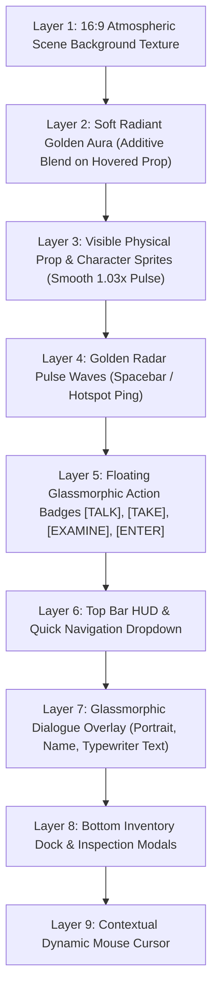
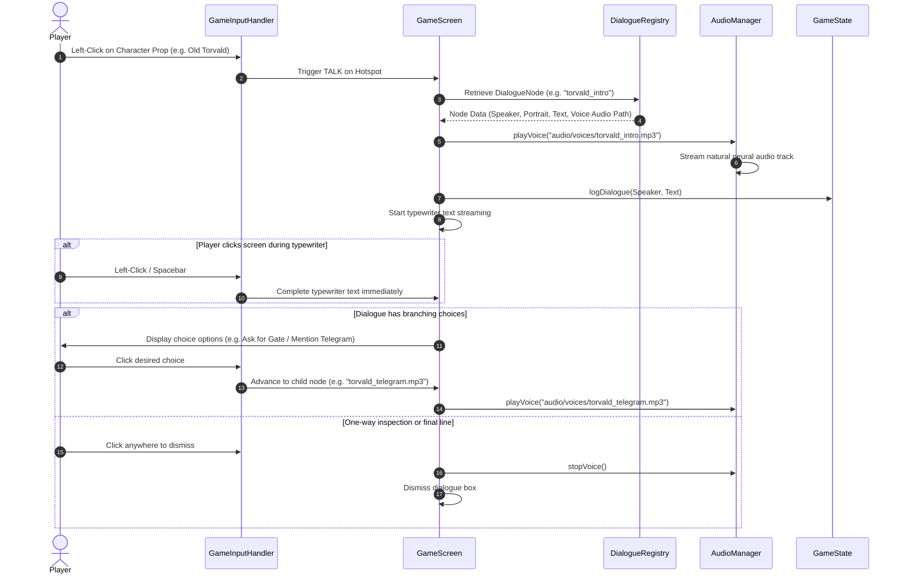
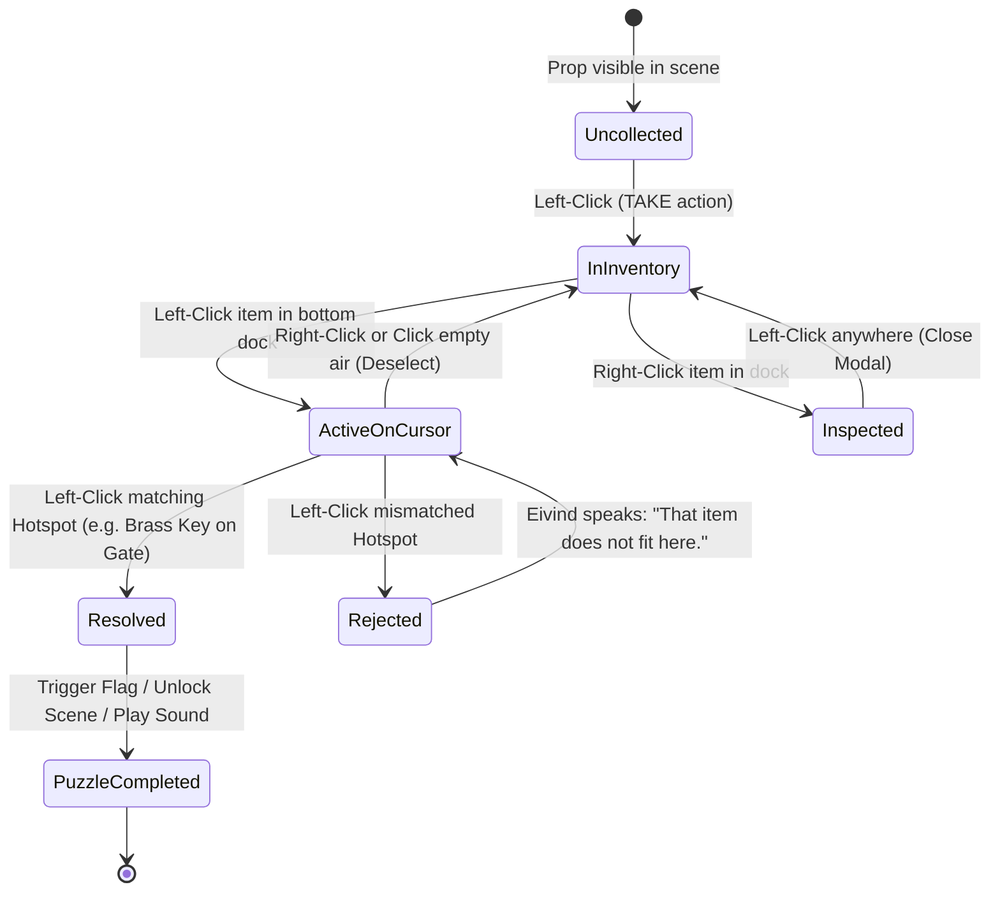

# The Mystery of Raven Island: Secret of the Keeper
### A Narrative-Driven Point-and-Click Adventure in LibGDX


**The Mystery of Raven Island** is a cinematic, atmospheric mystery-adventure built from the ground up in **LibGDX** (Java 21, LWJGL3). Inspired by classics such as *Myst*, *The Longest Journey*, *Return to Monkey Island*, and *Syberia*, the game features:
- A full 10-chapter narrative manuscript.
- Layered 16:9 scenic backdrops with physical, transparent visible prop and character sprites.
- Natural neural voice acting with **100% full-voice coverage**: Every character (Torvald, Astrid, UNIT-7), every clickable object, hotspot, door, and inspectable inventory item is fully spoken aloud by voice actors with exact text synchronization.
- Sophisticated point-and-click UX: soft golden auras (no crude yellow boxes), contextual action badges, a no-pixel-hunting radar ping system, an interactive inventory dock, item close-up inspection, and an expedition lore log.


### Lydfiler

| Lydspor | Spiller |
| :--- | :--- |
| **Eivind Cottage** | <audio controls src="https://github.com/user-attachments/files/33923336/eivind_cottage.mp3"></audio> |
| **Inspect Hotspot Pier Gate** | <audio controls src="https://github.com/user-attachments/files/33923332/inspect_hotspot_pier_gate.mp3"></audio> |
| **Item Punch Card** | <audio controls src="https://github.com/user-attachments/files/33923330/item_punch_card.mp3"></audio> |
| **Item Tuning Fork** | <audio controls src="https://github.com/user-attachments/files/33923329/item_tuning_fork.mp3"></audio> |
| **Unit 7 Tuning Fork** | <audio controls src="https://github.com/user-attachments/files/33923328/unit7_tuning_fork.mp3"></audio> |
| **Unit 7 Lore** | <audio controls src="https://github.com/user-attachments/files/33923326/unit7_lore.mp3"></audio> |


---

## 🏛️ 1. High-Level Engine Architecture

The game utilizes a decoupled, event-driven modular architecture running on top of LibGDX's LWJGL3 backend and `FitViewport(1280, 720)`.

```mermaid
flowchart TD
    subgraph HostPlatform["Desktop Host Platform"]
        Launcher["DesktopLauncher.java (LWJGL3 Application)"]
    end

    subgraph CoreEngine["Core Game Engine (RavnoyGame.java)"]
        GameLifecycle["Game Lifecycle Controller"]
        AssetMgr["LibGDX Asset / Texture Cache"]
        Batch["SpriteBatch & ShapeRenderer"]
        Audio["AudioManager (Ambient, SFX, Neural Voice)"]
        State["GameState (Inventory, Flags, Journal, Backlog)"]
        FontSys["FontManager (FreeType TTF Engine)"]
    end

    subgraph DataRegistries["Data & Content Registries"]
        SceneReg["SceneRegistry (10 Chapters, Visible Props, Exits)"]
        DiagReg["DialogueRegistry (Branching Trees, Voice Audio)"]
    end

    subgraph PresentationLayer["Presentation Layer (GameScreen.java)"]
        Viewport["FitViewport (1280x720 World Space)"]
        InputHandler["GameInputHandler (Mouse & Keyboard)"]
        SceneRenderer["Layered Scenic Renderer"]
        PropRenderer["Physical Prop & Character Sprite System"]
        DialogueHUD["Glassmorphic Dialogue Box & Typewriter"]
        InventoryDock["Interactive Inventory Dock & Inspector"]
        PingSystem["Radar Hotspot Ping (Spacebar / Button)"]
    end

    Launcher --> GameLifecycle
    GameLifecycle --> AssetMgr
    GameLifecycle --> Batch
    GameLifecycle --> Audio
    GameLifecycle --> State
    GameLifecycle --> FontSys
    GameLifecycle --> SceneReg
    GameLifecycle --> DiagReg

    GameLifecycle --> GameScreen
    GameScreen --> Viewport
    GameScreen --> InputHandler
    GameScreen --> SceneRenderer
    GameScreen --> PropRenderer
    GameScreen --> DialogueHUD
    GameScreen --> InventoryDock
    GameScreen --> PingSystem
```



---

## 🎨 2. Layered Scene Rendering Pipeline

To guarantee visual excellence and eliminate crude yellow highlight boxes, every scene is rendered in an 8-layer composite pipeline:



---

## 🗺️ 3. Scene Navigation & Island Topology

Players navigate seamlessly between the ten game chapters using smooth cross-fade scene transitions and contextual directional doorways:

```mermaid
graph LR
    S1["Chapter 1: The Fogbound Pier"] <-->|Stairs| S2["Chapter 2: Flooded Boathouse"]
    S1 <-->|Raven Gate Key| S3["Chapter 3: The Keeper's Study"]
    S3 <-->|Passage| S4["Chapter 4: Clockwork Workshop"]
    S4 <-->|Blast Portal| S5["Chapter 5: Tempestuous Sea Cliff"]
    S5 <-->|Runic Portal| S6["Chapter 6: Lighthouse Dynamo Staircase"]
    S6 <-->|Basalt Tunnel| S7["Chapter 7: Wreck of the North Star"]
    S6 <-->|Cage Lift| S8["Chapter 8: Subterranean Crystal Caverns"]
    S6 <-->|Spiral Stairs| S9["Chapter 9: Celestial Observatory"]
    S8 <-->|Express Hoist| S9
    S9 <-->|Crown Ladder| S10["Chapter 10: The Keeper's Core"]

    S10 -.->|Silver Lever| EA["Ending A: Harmonic Integration"]
    S10 -.->|Copper Lever| EB["Ending B: Controlled Damping"]
    S10 -.->|Crystal Lever| EC["Ending C: Cosmic Transmission"]

    classDef chapter fill:#1a233a,stroke:#d4af37,stroke-width:2px,color:#fff;
    classDef ending fill:#2e1534,stroke:#00e5ff,stroke-width:2px,color:#fff;
    class S1,S2,S3,S4,S5,S6,S7,S8,S9,S10 chapter;
    class EA,EB,EC ending;
```



---

## 🎙️ 4. Dialogue & Neural Voice System Flow

Every spoken line is 100% synchronized with its onscreen typewriter text, powered by high-fidelity neural voice files:



---

## 🎒 5. GameState, Inventory & Item Lifecycle



---

## 🎮 Controls Quick Reference

| Action | Input Control | Description |
|---|---|---|
| **Interact / Move / Speak** | **Left-Click** | Walk to scene, examine prop, speak to character, or select dialogue choice. |
| **Inspect Item in Detail** | **Right-Click** | Right-click any icon in the bottom inventory dock to inspect high-res art & lore. |
| **Use Item on World Object** | **Left-Click Item + Left-Click Prop** | Selects item to cursor; click target mechanism to use it. |
| **Deselect Active Item** | **Right-Click / Escape** | Clears the active item from the mouse cursor. |
| **Hotspot Radar Ping** | **`Spacebar` / `Tab`** | Pulses golden radar waves over all interactive elements on screen (no pixel-hunting). |
| **Dialogue Backlog History** | **Top Bar "Dialogue Log"** | Opens a scrollable transcript of all past spoken dialogue. |
| **Expedition Journal** | **Top Bar "Journal"** | Displays all collected clues, chapter lore, and active objectives. |
| **Fast Chapter Travel** | **Top Bar "Chapters ▾"** | Quick-jump dropdown menu to test any of the 10 scenes instantly. |
| **Mute / Unmute Audio** | **Top Bar "Audio"** | Toggles ambient soundscapes, voice lines, and sound effects. |

---

## 🚀 How to Build and Run the Game

### Prerequisites
- **Java Development Kit (JDK 17 or 21 LTS)** installed.
- **Gradle 8.14** wrapper is bundled directly in the project.

### Running via Terminal
Open PowerShell or your preferred terminal in the project directory:

```powershell
cd C:\dev\ravnoy_adventure
.\gradlew.bat run
```

### Building a Standalone Distribution
To compile a packaged, self-contained desktop distribution:

```powershell
cd C:\dev\ravnoy_adventure
.\gradlew.bat assemble
```
The executable distribution ZIP and TAR files will be generated in `build/distributions/`.

---

## 📁 Repository Structure

```
C:\dev\ravnoy_adventure/
├── assets/
│   ├── audio/
│   │   ├── music/       # Ambient maritime & spire hum drone (ambient.wav)
│   │   ├── sfx/         # Procedural SFX (click.wav, pickup.wav, door.wav, crystal.wav)
│   │   └── voices/      # High-fidelity natural neural speech files (.mp3 / .wav)
│   ├── fonts/           # TrueType font (font.ttf) with FreeType Norwegian character support
│   └── images/
│       ├── items/       # Inventory icons (key, lantern, telegram, prism, wrench, etc.)
│       ├── overlays/    # Transparent visible prop & character sprites
│       ├── portraits/   # Dialogue speaker avatars (Torvald, Astrid, UNIT-7, Eivind)
│       ├── scenes/      # High-res 16:9 scenic backdrops for all 10 chapters
│       └── ui/          # Contextual cursors, radar ping rings, and HUD buttons
├── src/main/java/com/ravnoy/adventure/
│   ├── DesktopLauncher.java # LWJGL3 Desktop entry point (1280x720 window)
│   ├── RavnoyGame.java      # LibGDX Game lifecycle, batch, and asset management
│   ├── audio/               # AudioManager with dual MP3/WAV neural voice streamer
│   ├── data/                # SceneRegistry & DialogueRegistry (10 Chapters, exact cues)
│   ├── model/               # Hotspot, InventoryItem, GameState, DialogueNode models
│   └── ui/                  # GameScreen, FontManager, layered rendering & HUD
├── build.gradle             # LibGDX 1.13.1 + FreeType configuration
├── gradlew.bat              # Gradle wrapper script
├── THE_MYSTERY_OF_RAVEN_ISLAND_STORY_AND_DESIGN.md # Complete story manuscript & bible
└── README.md                # System documentation, architecture & sequence diagrams
```
